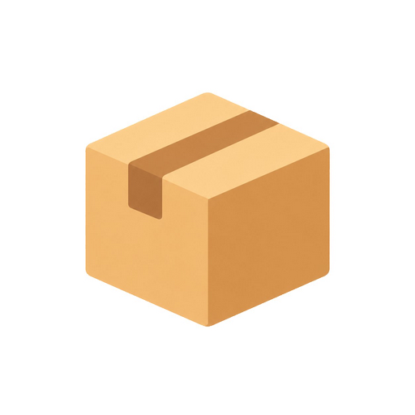
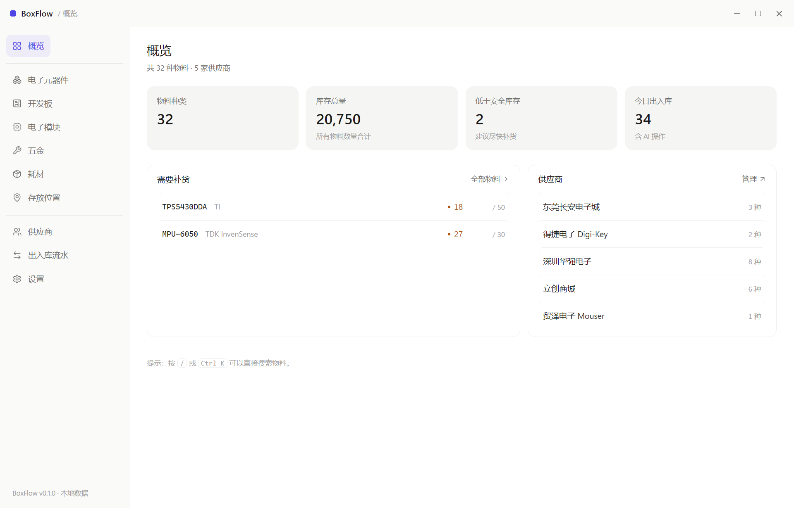
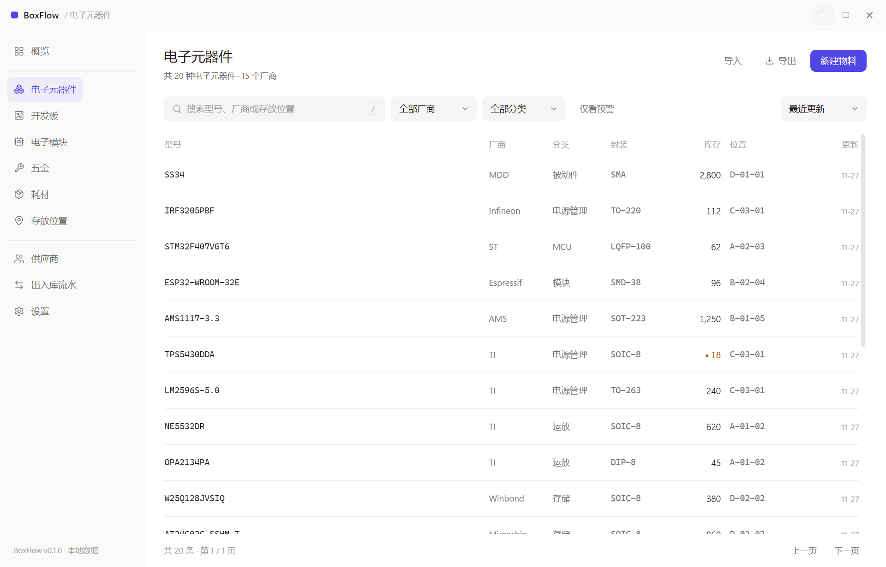
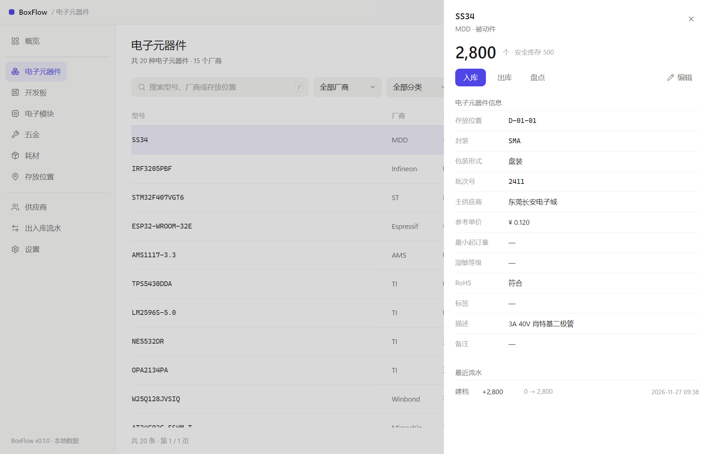

<div align="center">



# BoxFlow

**本地优先的电子物料库存管理桌面应用**

电子元器件 · 开发板 · 电子模块 · 五金 · 耗材，一个窗口全管住 —— 并且允许 AI 直接读写你的库存。

[](https://github.com/xiao-ni-qiu/BoxFlow/releases)
[](LICENSE)
[](#系统要求)
[](https://www.electronjs.org/)
[](#用-ai-管理库存mcp)

[功能](#功能) · [界面](#界面) · [下载安装](#下载安装) · [MCP 接入](#用-ai-管理库存mcp) · [本地开发](#本地开发) · [架构](#架构) · [贡献](#贡献)

</div>

---

## 这是什么

每个电子工程师的抽屉里都有一堆元件盒，时间一长就没人说得清：**某个型号还剩几个、放在哪个格子、上次是谁拿走的**。Excel 能记，但查起来慢、填起来烦、AI 也用不上。

BoxFlow 把这些事压缩到三秒之内：

- 打开就搜，输入型号 / 厂商 / 存放位置任意片段即时过滤；
- 入库出库只改一个数字，顺手把流水、位置、供应商一起记了；
- 库存低于安全线自动进「需要补货」；
- 数据全在本地一个 SQLite 文件里，**不联网也能用**；
- 内置 MCP 服务，WorkBuddy / Codex / 豆包工作版这类 AI 客户端可以直接帮你入库、查库存、盘点。

> 不是网页套壳：无边框窗口、自绘标题栏、纯平面设计系统，双击即用的 Windows 桌面程序。

## 功能

| 模块 | 说明 |
| --- | --- |
| 五大物料大类 | 电子元器件 / 开发板 / 电子模块 / 五金 / 耗材共用一套表结构，靠「大类」区分；字段文案随大类切换（五金叫规格、品牌、尺寸），无意义的字段自动隐藏 |
| 元件档案 | 型号、厂商、分类、封装、批次号、MSL 湿敏等级、RoHS、参考单价、最小起订量、包装形式、标签、备注 |
| 库存与位置 | 每个物料绑定存放位置（如 `A-01-02`）。新建时可直接从已有位置里挑，也能键入新编码，保存即自动建档；位置页可改名、改编码、补备注，被物料占用或仍有子位置时禁止删除 |
| 出入库流水 | 入库 / 出库 / 盘点三种操作，记录数量变化、时间与来源（手动或 AI），可按物料追溯历史 |
| 低库存预警 | 每个物料可设安全库存，低于阈值进入概览「需要补货」列表并醒目标红 |
| 供应商 | 供应商档案与物料关联，按供应商统计在管型号数 |
| 导入导出 | Excel `.xlsx` 与 CSV（兼容 GBK / UTF-8 BOM），导入前有字段映射与预检，导出保留列宽与冻结首行 |
| 桌面集成 | 系统托盘常驻、关闭到托盘、开机自启，均可在设置里开关；数据目录可迁移到 D 盘等任意位置，支持一键生成一致性备份 |
| 云端备份 | 支持 WebDAV（坚果云、Nextcloud 等）：整库快照上传、按份数自动清理旧备份、一键恢复（恢复前自动另存当前数据）、每日自动备份；应用密码用系统密钥加密存储 |
| MCP 服务 | 本机 HTTP 服务 + stdio 桥，14 个工具覆盖查询、入库、改档、盘点，AI 写入后界面实时刷新 |

## 界面

<div align="center">

**概览** —— 库存总量、补货提醒、供应商分布



**物料列表** —— 型号 / 厂商 / 分类 / 封装 / 库存 / 位置一屏可见



**详情抽屉** —— 不动页面就能入库、出库、盘点



</div>

## 下载安装

前往 [Releases](https://github.com/xiao-ni-qiu/BoxFlow/releases) 下载最新版：

```
BoxFlow-<版本号>-x64.exe
```

双击安装即可，无需单独装 Node.js 或数据库。安装包约 89 MB（Electron 运行时已内置）。

### 系统要求

- Windows 10 1809 及以上 / Windows 11，64 位
- 约 300 MB 磁盘空间（含运行时与数据）
- 无需管理员权限，默认安装到 `%LOCALAPPDATA%\Programs\BoxFlow`

### 数据存放位置

首次启动会创建：

```
%APPDATA%\BoxFlow\
├── data\inventory.db      # SQLite 主库（WAL 模式）
└── mcp-connection.json    # MCP 端口与令牌，供 AI 客户端自动发现
```

安装包**不会**在卸载时删除这个目录，升级或重装都不会丢库存。想换盘可以在「设置 → 数据目录」里迁移。

## 用 AI 管理库存（MCP）

这是 BoxFlow 与其他库存表格最不一样的地方：它同时是一个 MCP 服务器。

### 1. 打开服务

「设置 → MCP 服务」里确认开关已打开，界面会显示 `运行中 http://127.0.0.1:8788/mcp`、端口与访问令牌。服务**只绑定 127.0.0.1**，局域网与公网都访问不到。

### 2. 选择接入方式

**支持 HTTP 的客户端**（WorkBuddy 等）—— 把设置页里生成的 JSON 粘进配置，令牌已自动填好：

```json
{
  "mcpServers": {
    "boxflow": {
      "url": "http://127.0.0.1:8788/mcp",
      "headers": {
        "Authorization": "Bearer <设置页里显示你的访问令牌>"
      }
    }
  }
}
```

**只支持 stdio 的客户端**（Codex CLI、Claude Desktop 等）—— 用随程序附带的桥接脚本，它通过 `mcp-connection.json` 自动发现端口和令牌，不需要任何参数：

```json
{
  "mcpServers": {
    "boxflow": {
      "command": "node",
      "args": ["C:/Users/<用户名>/AppData/Local/Programs/BoxFlow/resources/bin/mcp-bridge.mjs"]
    }
  }
}
```

### 3. 直接说话

> 「把 100 个 10kΩ 0603 电阻入到 A-01-02，单价 0.01 元」
>
> 「STM32F407 还剩多少？分别在哪个位置？」
>
> 「列出低于安全库存的物料，按缺口排序」

AI 会自己调用工具完成建档、找位置、记流水，界面上会立刻看到变化。

### 工具清单

| 工具 | 用途 |
| --- | --- |
| `search_components` | 按关键词、大类、位置、库存状态检索物料 |
| `get_component` | 取单个物料的完整档案与近期流水 |
| `add_stock` | 入库；型号不存在时自动建档 |
| `bulk_add_stock` | 批量入库，适合一次录入整袋采购 |
| `remove_stock` | 出库，数量不足会拒绝并返回可用量 |
| `set_stock` | 盘点，把库存直接校正为实数 |
| `update_component` | 修改档案字段（价格、位置、安全库存等） |
| `archive_component` | 归档不再使用的型号（可恢复，不物理删除） |
| `list_low_stock` | 低于安全库存的物料 |
| `list_suppliers` / `add_supplier` | 供应商查询与新建 |
| `list_locations` | 存放位置及占用情况 |
| `list_movements` | 出入库流水，支持按物料与时间过滤 |
| `get_stats` | 概览统计：总数、库存总量、预警数、今日操作 |

## 本地开发

需要 Node.js 20+ 与 Windows（原生模块按 win32-x64 预编译）。

```bash
git clone https://github.com/xiao-ni-qiu/BoxFlow.git
cd BoxFlow
npm install        # postinstall 会自动把 better-sqlite3 匹配到 Electron 的 ABI
npm run dev        # 启动开发模式（热更新）
```

常用命令：

```bash
npm run typecheck  # TypeScript 全量类型检查
npm run build      # 类型检查 + 打包到 out/
npm run dist       # 生成 Windows 安装包到 dist/
npm run test:mcp   # 对本机运行中的实例跑 MCP 端到端自测
```

### 原生模块说明

`better-sqlite3` 是原生模块，Node 与 Electron 的 ABI 不同。`scripts/setup-native.mjs` 会在 `npm install` 后自动下载对应 Electron ABI 的预编译二进制（默认走 npmmirror，可用 `ELECTRON_MIRROR` / `BETTER_SQLITE3_MIRROR` 覆盖）。如果失败，手动执行：

```bash
npx @electron/rebuild -f -w better-sqlite3
```

## 架构

```
┌──────────────────────────────────────────────────────────────┐
│  BoxFlow.exe (Electron)                                      │
│                                                              │
│  ┌────────────────────┐  IPC   ┌───────────────────────────┐ │
│  │ 渲染进程 (React)    │◄──────►│ 主进程 (Node)              │ │
│  │ · 表格 / 表单 / 抽屉 │ 白名单 │ · IPC 路由 → service       │ │
│  │ · 无 Node 权限      │ 通道   │ · repository → SQLite     │ │
│  │ · contextIsolation │        │ · MCP HTTP :8788          │ │
│  └────────────────────┘        └────────────┬──────────────┘ │
└─────────────────────────────────────────────┼────────────────┘
                                              │
                          %APPDATA%\BoxFlow\data\inventory.db
                                              ▲
                                              │ 仅 127.0.0.1 + Bearer
                          ┌───────────────────┴───────────────┐
                          │ mcp-bridge.mjs（stdio ⇄ HTTP）     │
                          │ 供 WorkBuddy / Codex 等客户端调用   │
                          └───────────────────────────────────┘
```

分层约定：`ipc/` 与 `mcp/tools.ts` 只做参数校验与响应格式化，业务规则在 `modules/*/service.ts`，SQL 全部收敛在 `repository.ts`。渲染进程永远碰不到数据库和文件系统。

## 目录结构

```
src/
├── main/                 # 主进程
│   ├── db/               # 连接、迁移、示例数据
│   ├── modules/          # 业务域：components / locations / suppliers / movements / transfer
│   ├── mcp/              # MCP 服务端、工具定义、发现文件
│   ├── ipc/              # IPC 白名单路由
│   └── tray.ts window.ts settings.ts paths.ts
├── preload/              # 安全桥，暴露受限 API
├── renderer/             # React 界面（页面 / 组件 / 样式）
└── shared/               # 主进程与渲染进程共享的类型、常量、IPC 契约
docs/                     # 开发方案与截图
scripts/                  # 原生依赖准备、图标生成、MCP 自测
resources/bin/            # 随包分发的 MCP stdio 桥
```

## 路线图

- [x] v0.1 — 五大物料大类、库存与流水、导入导出、MCP 接入、托盘与自启
- [ ] 物料图片与数据手册附件
- [ ] 二维码 / 条码标签打印，扫码即查
- [ ] 批量编辑与多选操作
- [ ] 多仓库 / 多货架层级
- [ ] macOS 与 Linux 构建
- [ ] 中英双语界面

有想要的功能，欢迎到 [Issues](https://github.com/xiao-ni-qiu/BoxFlow/issues) 提，说明使用场景比只写功能名有用得多。

## 数据与隐私

- 所有数据只存在本机 `%APPDATA%\BoxFlow`，程序**不含任何遥测、统计或云端同步**；
- 唯一例外是你主动配置的 WebDAV 备份：只上传数据库快照，账号密码中的「应用密码」用系统密钥加密后存储，不写入配置文件明文；
- 唯一对外入口是 MCP 服务，仅监听 `127.0.0.1`，每次请求都要校验 Bearer 令牌，令牌可在设置页一键重置；
- 数据库使用 WAL 模式，异常退出不会损坏；导入前建议先导出一次备份；
- 卸载不删数据，确认不要了再手动删除数据目录。

## 贡献

欢迎 Issue、PR、使用反馈。提交前请读一遍 [CONTRIBUTING.md](CONTRIBUTING.md)；参与本项目即表示同意遵守 [行为准则](CODE_OF_CONDUCT.md)。安全问题请按 [SECURITY.md](SECURITY.md) 私下报告，不要开公开 Issue。

## 许可证

[Apache License 2.0](LICENSE) © 2026 xiao-ni-qiu

可自由商用、修改、分发，需保留版权与许可声明；修改过的文件需注明。详见 [LICENSE](LICENSE)。
